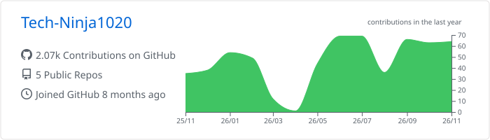
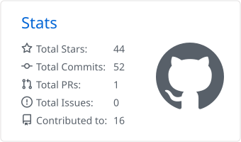
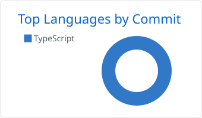

  

  

  

    
    
    
  

> 💻 **Senior Full Stack Engineer** | **Senior Mobile Engineer**
>
> 🚀 I build web and mobile products end to end in TypeScript: the interface, the API, the data layer, and the on-chain parts when a product needs them.

<table>
  <tr>
    <td width="33%" valign="top" align="center">
      <h3>🌐 Full Stack Web</h3>
      
React and TypeScript frontends on Node.js backends, with strict typing and tested business logic.

    </td>
    <td width="33%" valign="top" align="center">
      <h3>📱 Mobile</h3>
      
Cross-platform iOS and Android apps with React Native and Expo, backed by Supabase.

    </td>
    <td width="33%" valign="top" align="center">
      <h3>⛓️ AI &amp; Web3</h3>
      
AI-powered product features and Solana programs written in Rust with Anchor.

    </td>
  </tr>
</table>

## 🎯 What I Do

- 🔭 Working on **AI-powered mobile apps** and **full stack web applications**
- 🧮 Building **finance tools** where every number has to be exact and traceable
- ⛓️ Shipping **Solana smart contracts** with wallet-based auth and escrow payments
- 🐘 Exploring **PostgreSQL internals** and extensions
- 💬 Ask me about **React, React Native, TypeScript, Node.js**

## 🛠️ Tech Stack &amp; Tools

<table>
  <tr>
    <td><b>Languages</b></td>
    <td>
      
      
      
      
      
      
      
      
      
      
      
      
      
      
      
    </td>
  </tr>
  <tr>
    <td><b>Frontend</b></td>
    <td>
      
      
      
      
      
      
      
      
      
      
      
      
      
      
      
      
      
    </td>
  </tr>
  <tr>
    <td><b>Backend</b></td>
    <td>
      
      
      
      
      
      
      
      
      
      
      
      
      
      
      
      
    </td>
  </tr>
  <tr>
    <td><b>Mobile</b></td>
    <td>
      
      
      
      
      
      
    </td>
  </tr>
  <tr>
    <td><b>Databases</b></td>
    <td>
      
      
      
      
      
      
      
      
    </td>
  </tr>
  <tr>
    <td><b>Cloud &amp; DevOps</b></td>
    <td>
      
      
      
      
      
      
      
      
      
    </td>
  </tr>
  <tr>
    <td><b>Web3</b></td>
    <td>
      
      
      
      
    </td>
  </tr>
  <tr>
    <td><b>Testing &amp; Tools</b></td>
    <td>
      
      
      
      
      
      
      
      
      
      
    </td>
  </tr>
</table>

## 🚀 Featured Projects

<table>
  <tr>
    <td colspan="2" valign="top">
      <h3><a href="https://github.com/Tech-Ninja1020/Luggage-AI">🧳 Luggage AI (Attire)</a></h3>
      
An intelligent travel packing companion for iOS and Android. It combines AI-powered outfit planning, smart packing checklists and airline baggage guidance in one app.

      
      
      
      
      
      
    </td>
  </tr>
  <tr>
    <td width="50%" valign="top">
      <h3><a href="https://github.com/Tech-Ninja1020/hireonchain">⛓️ HireOnChain</a></h3>
      
A decentralized job marketplace on Solana. Employers post jobs, freelancers bid, and payments are held in an on-chain escrow, with wallet-based sign-in.

      
      
      
      
      
    </td>
    <td width="50%" valign="top">
      <h3><a href="https://github.com/Tech-Ninja1020/Hold-Sell-Exchange">🏠 Hold / Sell / Exchange</a></h3>
      
A simulator for rental property owners that compares holding, selling, and a 1031 exchange after tax, month by month. Money is integer cents, and every input carries its source.

      
      
      
      
      
    </td>
  </tr>
</table>

## 📊 GitHub Stats

  <picture>
    <source media="(prefers-color-scheme: dark)" srcset="https://raw.githubusercontent.com/Tech-Ninja1020/Tech-Ninja1020/output/cards/dark/0-profile-details.svg" />
    
  </picture>

  <picture>
    <source media="(prefers-color-scheme: dark)" srcset="https://raw.githubusercontent.com/Tech-Ninja1020/Tech-Ninja1020/output/cards/dark/3-stats.svg" />
    
  </picture>
  <picture>
    <source media="(prefers-color-scheme: dark)" srcset="https://raw.githubusercontent.com/Tech-Ninja1020/Tech-Ninja1020/output/cards/dark/2-most-commit-language.svg" />
    
  </picture>

## 🔥 Streak Stats

  

## 🐍 Contribution Snake

  <picture>
    <source media="(prefers-color-scheme: dark)" srcset="https://raw.githubusercontent.com/Tech-Ninja1020/Tech-Ninja1020/output/github-snake-dark.svg" />
    <source media="(prefers-color-scheme: light)" srcset="https://raw.githubusercontent.com/Tech-Ninja1020/Tech-Ninja1020/output/github-snake.svg" />
    
  </picture>

